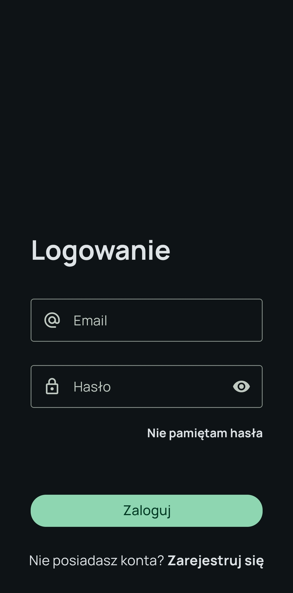
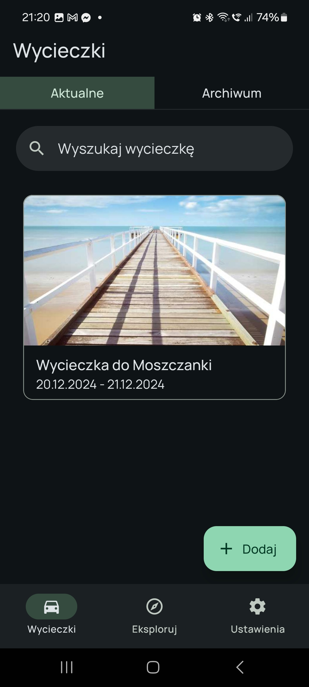
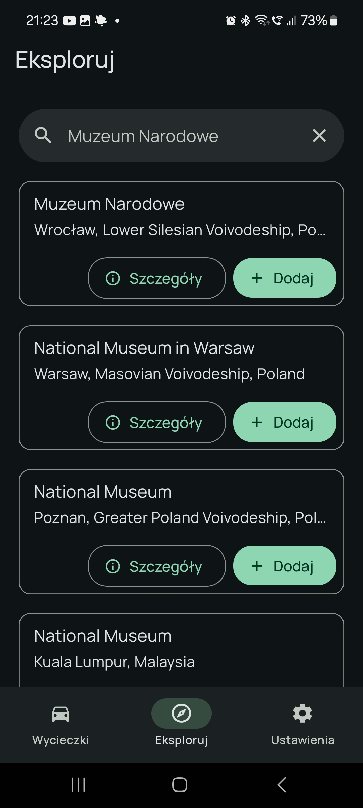
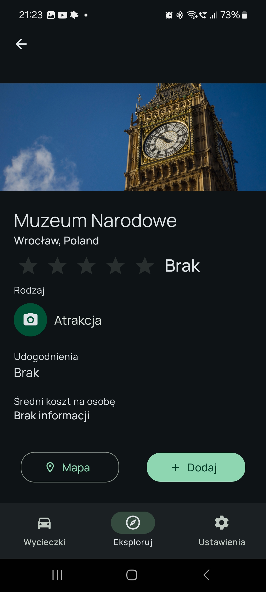
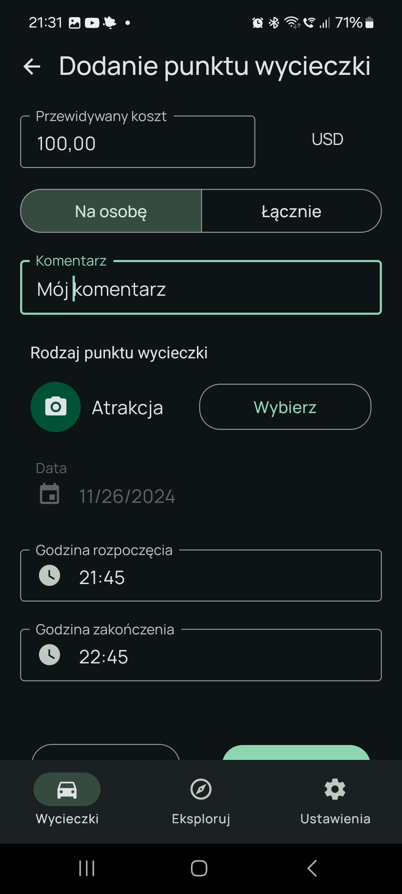
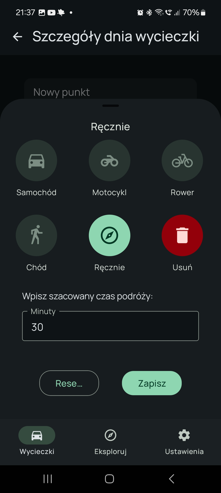
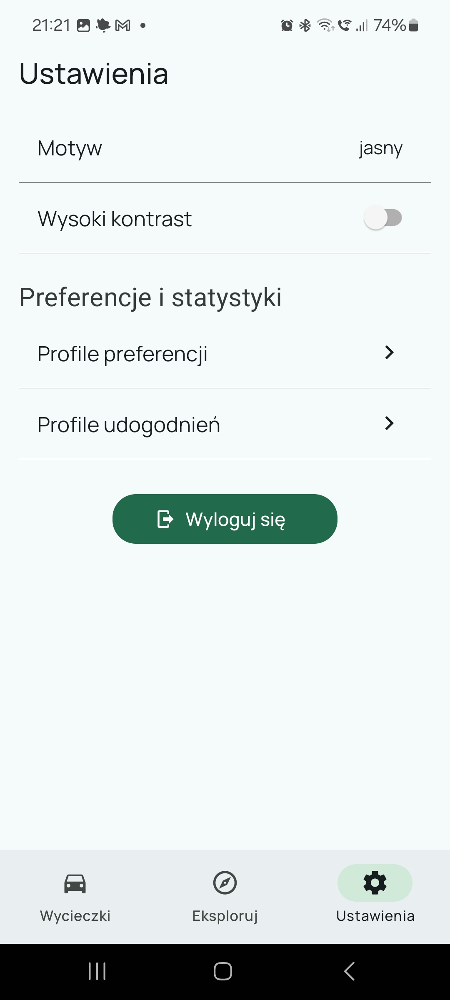
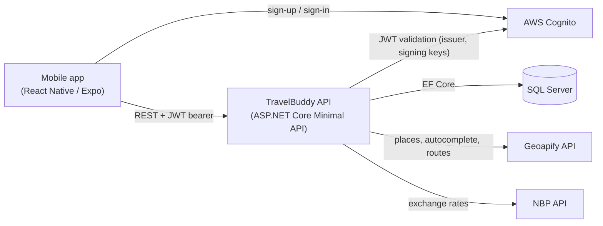

# TravelBuddy

A mobile trip planner for Android: multi-day trips, a per-day plan of trip points and transfers, budget tracking, and attraction suggestions filtered by the user's interests and required amenities.

TravelBuddy started as a university team project (ZPI, Wrocław University of Science and Technology, Oct–Dec 2024). The graded state is tagged [`zpi-final`](https://github.com/M4tth3wG/travelbuddy-redesign/tree/zpi-final). The project was then extended in 2025 and is now kept as a portfolio repository. The original team repository is [zpi-travelbuddy/travelbuddy](https://github.com/zpi-travelbuddy/travelbuddy).

> The app UI and the domain documentation in [`docs/`](docs/) are in Polish.

## Problem

General-purpose travel apps tend to focus on routes and generic suggestions. They give little help to people who want to plan a trip around specific interests (art, history, nature) or constraints such as wheelchair access, diet or travelling with a dog. The TravelBuddy team set out to build a planner that:

- keeps a whole trip, day by day, with trip points, transfers between them and expected costs,
- suggests single attractions near the trip destination that match a **preference profile** (place categories) and an **amenity profile** (e.g. wheelchair access, vegetarian/vegan options, dog-friendly, internet access),
- lets users record what a visit actually cost and how long it took.

## Features

State at `zpi-final`, unless noted otherwise:

- Sign up, sign in and password reset (AWS Cognito)
- Trips list with current and archived trips; create, edit and delete trips (destination autocomplete, dates, number of people, budget and currency)
- Trip days with trip points added in three ways: a manual form, attraction search, or recommendations for the trip
- Transfers between trip points: travel time estimated by mode (car, motorcycle, bike, walk) or entered manually; route opened in Google Maps
- Trip point review after a visit (actual cost, duration, rating), and a predicted vs actual trip cost summary; costs in the trip's currency are converted using NBP exchange rates
- Adding trip points to the device calendar, and reminders as local notifications
- Preference and amenity profiles, with one profile of each kind markable as favourite
- Light/dark theme and high-contrast mode
- *2025:* trip note, adding a whole trip day to the calendar, alternative UI variants (see [Project history](#project-history))

<table>
  <tr>
    <td></td>
    <td></td>
    <td></td>
    <td></td>
  </tr>
  <tr>
    <td></td>
    <td></td>
    <td></td>
    <td></td>
  </tr>
</table>

*Screenshots from an Android device, November 2024 (UI variant `v1`).*

## Tech stack

| Area | Technologies |
| --- | --- |
| Mobile app (`app/`) | React Native 0.74, Expo SDK 51, expo-router, TypeScript, React Native Paper, aws-amplify (Cognito), axios, expo-calendar, expo-notifications |
| Backend (`backend/`) | .NET 8, ASP.NET Core Minimal API, Entity Framework Core 8, SQL Server, RestSharp, Swagger (Swashbuckle) |
| Tests | xUnit, Moq, EF Core InMemory |
| External services | AWS Cognito (auth), Geoapify (places, autocomplete, routing), NBP API (exchange rates) |
| Tooling | Docker / Docker Compose, GitHub Actions, EAS Build |

## Architecture



- **App:** file-based routing in `app/app/`. Screens live in `app/views/` and shared UI in `app/components/`. All backend calls go through the axios instance exposed by `useAuth().api` ([`app/app/ctx.tsx`](app/app/ctx.tsx)), which attaches the Cognito access token.
- **Backend:** endpoint groups in `Endpoints/` (trips, trip points, transfer points, places, category/condition profiles, favourites) call services behind interfaces in `Interfaces/`. The services use `TravelBuddyDbContext`. `GeoapifyClient` and `NBPClient` wrap the external APIs, and `TravelBuddyDbCache` keeps place categories and conditions in memory. EF Core migrations run on startup.
- **Recommendations:** nearby places around the trip destination come from Geoapify. They are filtered by the categories in the trip's preference profile and, optionally, by the conditions in its amenity profile.

### Deployment at `zpi-final` (no longer in this repo)

At `zpi-final`, the backend image was built and pushed to Docker Hub by a manually triggered GitHub Actions workflow and then run on Azure Container Instances. The database was Azure SQL Database, and secrets came from Azure Key Vault. The app was installed on devices from an `.apk`. The Azure-specific code was removed later, so the repository now runs locally only (see below).

## Getting started

### Prerequisites

- Docker (for the local stack) or the .NET 8 SDK plus a SQL Server instance
- Node.js and npm, and Expo Go or an Android emulator/device
- Your own AWS Cognito user pool and a Geoapify API key

### Backend

With Docker Compose (SQL Server + API):

```bash
cd backend/TravelBuddyAPI
cp .env.example .env   # fill in the placeholders
docker compose up
```

The API is exposed on host port 80. The template defaults to `ASPNETCORE_ENVIRONMENT=Production`. With `Development`, Swagger UI is available at `/swagger`, but the development-only `/geoapify/*` and `/nbp/*` endpoints are also mapped **without authentication**. Use `Development` only on a trusted machine and network.

> **Note:** `docker-compose.yml` publishes the API (port 80) and SQL Server with the `sa` login (port 1433) on all network interfaces. Run the stack on a trusted network, or change the port mappings to `127.0.0.1:<port>:<port>`.

Without Docker, set the four required settings through user secrets (or environment variables), then run the API:

```bash
cd backend
dotnet user-secrets set "ConnectionStrings:TravelBuddyDb" "<connection string>" --project TravelBuddyAPI
dotnet user-secrets set "Geoapify:Key" "<geoapify-api-key>" --project TravelBuddyAPI
dotnet user-secrets set "Cognito:Authority" "https://cognito-idp.<region>.amazonaws.com/<user-pool-id>" --project TravelBuddyAPI
dotnet user-secrets set "Cognito:Audience" "<cognito-audience>" --project TravelBuddyAPI
dotnet run --project TravelBuddyAPI
```

The default launch profile listens on `http://localhost:5142` only. To reach the API from a phone or emulator, bind it to all interfaces:

```bash
dotnet run --project TravelBuddyAPI --urls http://0.0.0.0:5142
```

Tests:

```bash
cd backend
dotnet test
```

The NBP client tests call the real NBP API and need internet access.

### Mobile app

```bash
cd app
cp .env.example .env   # API URL, Cognito settings, UI variant
npm install
npm start
```

`EXPO_PUBLIC_FEATURE_VERSION` selects the UI variant (`v1` is the baseline, plus `v2` and `v3`). Development, preview (`.apk`) and production builds are described in [`app/README.md`](app/README.md). `build:dev` and `build:prev` load optional `.env.development` and `.env.preview` overrides on top of `.env`. If those files are missing, the build uses the base `.env` values, so create them when a build needs a different API URL. Linting: `npm run lint`.

## Project history

### 2024: ZPI team project

A four-person team (Igor Banaszak, Adrian Broniecki, Bartosz Gableta, Mateusz Gazda) supervised by dr inż. Marcin Kawalerowicz. The team worked in two-week Scrum sprints, tracked in Jira. The final state is tagged [`zpi-final`](https://github.com/M4tth3wG/travelbuddy-redesign/tree/zpi-final) (commit `456f2d5`, 13 Dec 2024).

**My role: backend.** Based on my commits up to `zpi-final`:

- Analysis of tourist-attraction APIs, then backend environment setup, domain model, database schema and the endpoint contract
- Geoapify client: place search, autocomplete, route time; in-memory caching of place categories and conditions
- Trips and trip points: create and edit endpoints, transactions, overlap detection between trip points, and automatic deletion of conflicting transfers
- Authentication: first an Azure AD B2C integration, then the AWS Cognito JWT configuration
- Infrastructure: Dockerfile and Docker Compose with database setup, Azure Key Vault and Azure SQL Database integration, the staging CI/CD pipeline (GitHub Actions → Docker Hub → Azure Container Instances), and HTTPS configuration
- Place recommendations, preference profile management, trip point status, predicted vs actual trip cost summary
- Data quality fixes for provider places: duplicate and invalid place filtering, opening-hours parsing, consistent place names

### 2025: Redesign

Work from October 2025 to January 2026 on top of `zpi-final`, by Mateusz Gazda and Adrian Broniecki.

Backend (my part):

- Simplified configuration: settings injected through environment variables, plus handling of an incorrect DB connection string
- Simplified Docker Compose setup and added CORS
- New `Note` field on `Trip`, with the `AddNoteToTrip` migration and `TripsService` support

### 2026: Portfolio maintenance

Bug fixes with regression tests: the trip edit no longer overwrites the trip note, editing a trip point now updates its place, startup fails fast on DB errors and applies CORS before auth, and existing provider places are filtered correctly. The Key Vault, Azure Identity and DotNetEnv packages, the Key Vault secret manager and the Azure staging workflow were also removed. The unused `Microsoft.Identity.Web` packages from the earlier Azure AD B2C integration are still referenced in the project file.

## Documentation

Domain and requirements documents (Polish) are in [`docs/`](docs/):

- [Project premise](docs/project_premise.md)
- [Functional requirements](docs/functional-requirements.md)
- [Glossary](docs/glossary.md)
- [Responsibility diagram](docs/responsibility-diagram.md)

Research notes from the start of the project are in [`others/`](others/).
